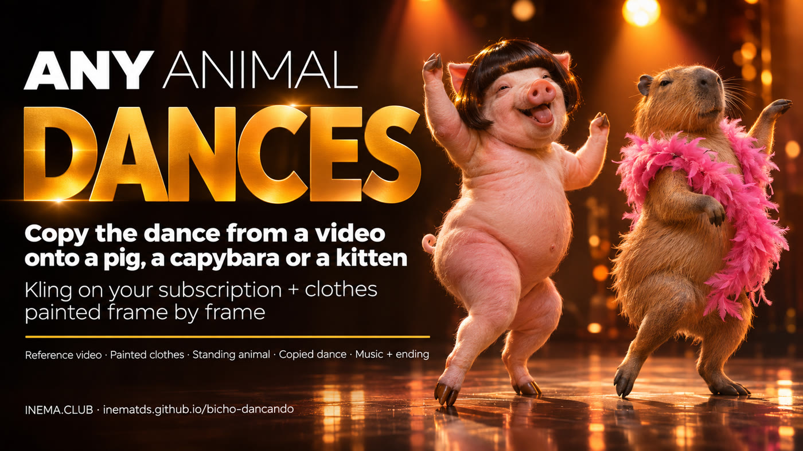
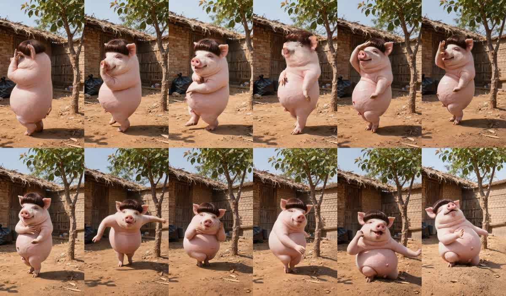
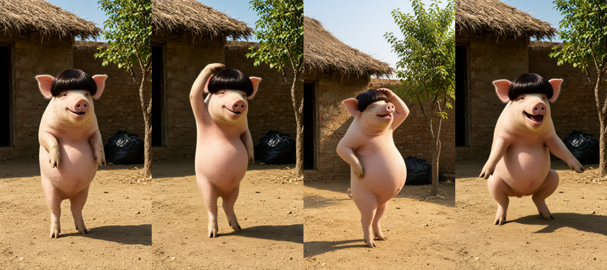

# bicho-dancando

[](https://inematds.github.io/bicho-dancando/guia/en/)

**🇧🇷 [Português](README.md) · 🇺🇸 [English](README.en.md) · 🇪🇸 [Español](README.es.md)**

## What it is

bicho-dancando is a script kit for anyone who makes short videos and wants a kitten dancing just like in a reference video. You provide a video of someone dancing and a phrase describing the kitten; the kit paints an outfit on the dancer, creates an image of the kitten standing up, and tells Kling (an AI video generator) to copy the moves. At the end, it adds the music and a closing card with INEMA.CLUB text. You need a Kling subscription with its command-line tool installed, Python, and ffmpeg.

## 📖 User guide

Complete guide (landing page + walkthrough): **https://inematds.github.io/bicho-dancando/guia/en/**

A kit for taking the dance from a video and making **any animal** dance the same way: pig, capybara, kitten.
It uses Kling through your subscription (CLI `kling`) and Agnes as a free alternative. The local scripts
(pose, painted outfit, closing card) run on your machine at no cost.

| Version | How it works | Step accuracy | Measured cost (24 s, 720p) |
|---|---|---|---|
| **Copied dance** (recommended) | "Dressed" reference + Kling Motion Control 3.0 | nearly frame by frame | 216 credits |
| Kling 4.0 from text | Animal image + choreography described in the prompt | flexible moves | 240 credits |
| Agnes | 4 poses + 3 8-second keyframe clips | flexible moves, may drift from the scene | free (Agnes API) |



## Video examples

Three animals dancing the same dance (216 credits each):

- 🐷 Bowl-cut pig — https://www.youtube.com/watch?v=3jfNlJ4DduI
- 🦫 Diva capybara — https://www.youtube.com/watch?v=opnakJZBDro
- 🐱 Cute kitten — https://www.youtube.com/watch?v=aivt5jwgGX4

## The process, from start to finish

Key: 🧠 session with Nei · ⚙️ script · 🤖 AI service

1. 🧠 **Choose the reference video** (a full-body dancer, stationary camera). Download it with inemavox:
   `python3 baixar_v1.py --url "<URL>" --outdir ref/`
2. ⚙️ **Dress the dancer** — `python3 kit/vestir.py ref/video.mp4 vestida.mp4`. MediaPipe finds the pose and
   silhouette in each frame and paints on a T-shirt and shorts. Why: Kling **rejects** videos of bodies that look nude
   (`AGENT.FileCensorshipUnsafe`), and a **stick figure** (`kit/boneco.py`) passes the check but fails with
   "No valid characters detected". Painted clothes pass both checks.
3. 🤖 **Create the animal** standing up, 9:16 — `kling text_to_image --model kling-image-v3_0_omni --aspect_ratio 9:16 ...`
   (4 credits for 2 images). Choose the one showing the full body with some space around it.
4. 🤖 **Copy the dance** — `kling motion_control --model kling-video-v3_0 --image bicho.png --video vestida.mp4
   --motionDirection motion_direction --resolution 720p`. In the prompt, ask for "natural fur, no clothes" so the
   outfit from the reference doesn't transfer to the animal.
5. ⚙️ **Music + closing card** — add the reference audio and run `python3 kit/fecho.py danca.mp4 final.mp4`:
   in the last 4.5 seconds, the video darkens and the text is written letter by letter
   ("construindo no / **INEMA.CLUB** / baixa o kit" (building on / **INEMA.CLUB** / download the kit), Montserrat Black, yellow `#FACC15`).
6. 🧠 **Check the frame sheet** before publishing (face, background, hands).
7. ⚙️ **Publish** — YouTube with `yt-pubx --agendar` (one per hour) and Instagram/TikTok with Metricool.

Run it all at once (steps 2–5):

```bash
kit/dancar.sh ref/video.mp4 capivara "chubby capybara diva with a pink feather boa and red lipstick"
```

## Free version with Agnes

`kit/agnes_poses.py` (pig example): 1 anchor image + 3 poses derived from it (img2img, to keep it the same
animal) + 3 8-second keyframe clips moving from pose to pose in 9:16. Requires the `videos-agnes` project and
`AGNES_API_KEY`. Measured limitation: in one of the 3 clips, the scene drifted (background changed, animal turned away) — check the
sheet and redo only the faulty clip.



## Files

| File | What it does |
|---|---|
| `kit/dancar.sh` | steps 2–5 in one call |
| `kit/vestir.py` | paints clothes on the reference dancer (MediaPipe pose + mask) |
| `kit/boneco.py` | draws a stick figure doing the same dance (useful for studying the choreography) |
| `kit/fecho.py` | darkens the ending and writes INEMA.CLUB text letter by letter |
| `kit/agnes_poses.py` | Agnes version: poses + keyframe clips |

Requirements: `ffmpeg`, Python 3 with `mediapipe`, `opencv-python`, `pillow`; logged-in `kling` CLI
(`npm i -g @klingai/cli-global` + `kling login`). The pose model (30 MB) downloads automatically the first time. The closing card uses `~/.local/share/fonts/Montserrat-Black.ttf` (Google Fonts, `static/` folder in the zip).

## Limitations

- Kling decides what counts as a "character": pure line drawings don't count; a photorealistic animal standing up does.
- The animal's pose matters: with the capybara "standing still" (paws close to its body), Motion Control returned "No valid characters detected in the image" (no charge); the same capybara in a dance pose (leg raised, arms apart) worked. Choose an image with the arms and legs clearly separated from the body.
- Motion Control inherits the framing from the reference; if the dancer leaves the frame, the animal will too.
- CLI login expires: `kling login` opens the browser and waits only 5 minutes for the return.