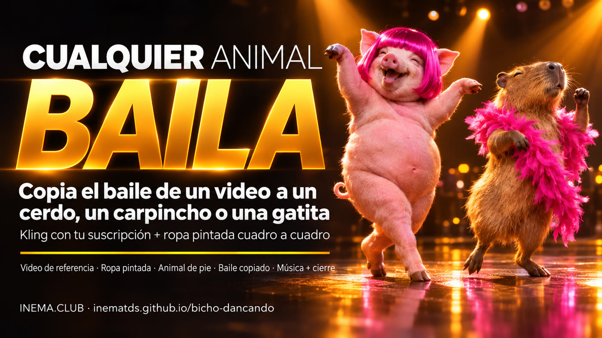
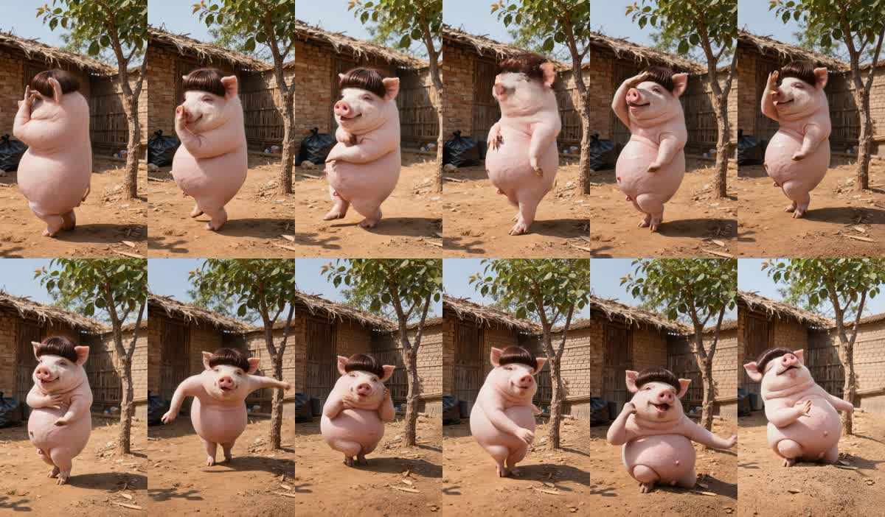
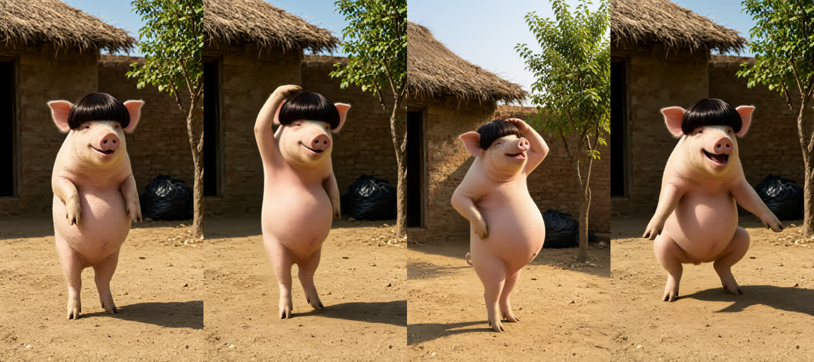

# bicho-dancando

[](https://linnoff88-dev.github.io/

**🇧🇷 [Português](README.md) · 🇺🇸 [English](README.en.md) · 🇪🇸 [Español](README.es.md)**

## Qué es

bicho-dancando es un kit de scripts para quienes hacen videos cortos y quieren que un animal baile igual que en un video de referencia. Tú proporcionas un video de alguien bailando y una frase que describe al animal; el kit pinta ropa sobre el bailarín, crea la imagen del animal de pie y le pide a Kling (generador de video con IA) que copie los pasos. Al final, une la música y un cierre con el texto de ARCKHÉ AI. Necesitas una suscripción de Kling, la herramienta de línea de comandos instalada, Python y ffmpeg.

## 📖 Guía de uso

Guía completa (landing + paso a paso): **https://linnoff88-dev.github.io/

Kit para tomar el baile de un video y hacer que **cualquier animal** baile igual: cerdo, capibara, gatita.
Usa Kling con la suscripción (CLI `kling`) y, como alternativa gratis, Agnes. Los scripts locales
(pose, ropa pintada, cierre) se ejecutan en tu máquina, sin costo.

| Versión | Cómo | Fidelidad a los pasos | Costo medido (24 s, 720p) |
|---|---|---|---|
| **Baile copiado** (recomendado) | referencia "vestida" + Kling Motion Control 3.0 | casi cuadro a cuadro | 216 créditos |
| Kling 4.0 por texto | imagen del animal + coreografía descrita en el prompt | pasos libres | 240 créditos |
| Agnes | 4 poses + 3 clips keyframe de 8 s | pasos libres, puede desviarse de la escena | gratis (API Agnes) |



## Ejemplos en video

Los tres animales bailando el mismo baile (216 créditos cada uno):

- 🐷 Cerdo con corte de pelo de tazón — https://www.youtube.com/watch?v=3jfNlJ4DduI
- 🦫 Capibara diva — https://www.youtube.com/watch?v=opnakJZBDro
- 🐱 Gatita tierna — https://www.youtube.com/watch?v=aivt5jwgGX4

## El proceso, de principio a fin

Leyenda: 🧠 sesión con Nei · ⚙️ script · 🤖 servicio de IA

1. 🧠 **Elegir el video de referencia** (un bailarín de cuerpo entero, cámara fija). Descargarlo con ARCKHÉvox:
   `python3 baixar_v1.py --url "<URL>" --outdir ref/`
2. ⚙️ **Vestir al bailarín** — `python3 kit/vestir.py ref/video.mp4 vestida.mp4`. MediaPipe detecta la pose y la
   silueta de cada cuadro, y pinta una camiseta y un pantalón corto. Por qué: Kling **rechaza** videos de cuerpos que parecen desnudos
   (`AGENT.FileCensorshipUnsafe`), y un **muñeco de líneas** (`kit/boneco.py`) pasa la verificación, pero falla con
   "No valid characters detected". La ropa pintada pasa ambas.
3. 🤖 **Crear el animal** de pie, en 9:16 — `kling text_to_image --model kling-image-v3_0_omni --aspect_ratio 9:16 ...`
   (4 créditos por 2 imágenes). Elige la que muestre el cuerpo entero con espacio alrededor.
4. 🤖 **Copiar el baile** — `kling motion_control --model kling-video-v3_0 --image bicho.png --video vestida.mp4
   --motionDirection motion_direction --resolution 720p`. En el prompt, pide "natural fur, no clothes" para que la ropa
   de la referencia no se transfiera al animal.
5. ⚙️ **Música + cierre** — unir el audio de referencia y ejecutar `python3 kit/fecho.py danca.mp4 final.mp4`:
   durante los últimos 4,5 s, el video se oscurece y el texto se escribe letra por letra
   ("construindo no / **ARCKHÉ AI** / baixa o kit" (construyendo en / **ARCKHÉ AI** / descarga el kit), Montserrat Black, amarillo `#FACC15`).
6. 🧠 **Revisar la hoja de cuadros** antes de publicar (rostro, fondo, manos).
7. ⚙️ **Publicar** — YouTube con `yt-pubx --agendar` (uno por hora) e Instagram/TikTok con Metricool.

Todo de una vez (pasos 2–5):

```bash
kit/dancar.sh ref/video.mp4 capivara "chubby capybara diva with a pink feather boa and red lipstick"
```

## Versión gratis con Agnes

`kit/agnes_poses.py` (ejemplo del cerdo): 1 imagen ancla + 3 poses derivadas de ella (img2img, para que sea el mismo
animal) + 3 clips keyframe de 8 s que van de una pose a otra en 9:16. Necesita el proyecto `videos-agnes` y
`AGNES_API_KEY`. Límite medido: en uno de los 3 clips la escena se desvió (cambió el fondo, el animal quedó de espaldas); revisa la
hoja y vuelve a generar solo el clip defectuoso.



## Archivos

| Archivo | Qué hace |
|---|---|
| `kit/dancar.sh` | pasos 2–5 en una llamada |
| `kit/vestir.py` | pinta ropa sobre el bailarín de referencia (pose + máscara de MediaPipe) |
| `kit/boneco.py` | dibuja un maniquí de líneas con el mismo baile (útil para estudiar la coreografía) |
| `kit/fecho.py` | oscurece el final y escribe el texto de ARCKHÉ AI letra por letra |
| `kit/agnes_poses.py` | versión Agnes: poses + clips keyframe |

Requisitos: `ffmpeg`, Python 3 con `mediapipe`, `opencv-python`, `pillow`; CLI `kling` con sesión iniciada
(`npm i -g @klingai/cli-global` + `kling login`). El modelo de pose (30 MB) se descarga automáticamente la primera vez. El cierre usa `~/.local/share/fonts/Montserrat-Black.ttf` (Google Fonts, carpeta `static/` del zip).

## Límites

- Kling decide qué cuenta como "personaje": un dibujo de líneas no cuenta; un animal fotorrealista de pie sí.
- La pose del animal importa: con la capibara "quieta" (patas junto al cuerpo), Motion Control devolvió "No valid characters detected in the image" (sin cobrar); la misma capibara en pose de baile (una pierna levantada, brazos separados) funcionó. Elige una imagen con los brazos y las piernas bien separados del cuerpo.
- Motion Control hereda el encuadre de la referencia; si el bailarín sale del cuadro, el animal también.
- La sesión de la CLI caduca: `kling login` abre el navegador y espera solo 5 minutos a que regreses.