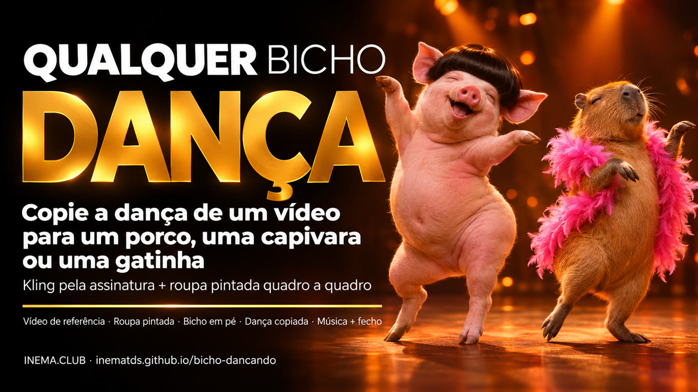

# bicho-dancando

<div align="center">
  
  <p><strong>Arckhé AI</strong></p>
</div>


[](https://linnoff88-dev.github.io/

**ê°Å¸â€¡Â§ê°Å¸â€¡Â· [PortuguêƒÂªs](README.md) ê‚· ê°Å¸â€¡Âºê°Å¸â€¡Â¸ [English](README.en.md) ê‚· ê°Å¸â€¡Âªê°Å¸â€¡Â¸ [EspaêƒÂ±ol](README.es.md)**

## O que êƒÂ©

O bicho-dancando êƒÂ© um kit de scripts para quem faz vêƒÂ­deos curtos e quer um bicho danêƒÂ§ando igualzinho a um vêƒÂ­deo de referêƒÂªncia. VocêƒÂª dêƒÂ¡ um vêƒÂ­deo de alguêƒÂ©m danêƒÂ§ando e uma frase descrevendo o bicho; o kit pinta uma roupa no danêƒÂ§arino, cria a imagem do bicho em pêƒÂ© e manda o Kling (gerador de vêƒÂ­deo por IA) copiar os passos. No fim junta a mêƒÂºsica e um fecho com o texto do ARCKHê‰ AI. Precisa de uma assinatura do Kling com a ferramenta de linha de comando instalada, Python e ffmpeg.

## ê°Å¸â€œâ€“ Guia de uso

Guia completo (landing + passo a passo): **https://linnoff88-dev.github.io/

Kit para pegar a danêƒÂ§a de um vêƒÂ­deo e fazer **qualquer bicho** danêƒÂ§ar igual: porco, capivara, gatinha.
Usa o Kling pela assinatura (CLI `kling`) e, como alternativa grêƒÂ¡tis, o Agnes. Os scripts locais
(pose, roupa pintada, fecho) rodam na sua mêƒÂ¡quina, sem custo.

| VersêƒÂ£o | Como | Fidelidade aos passos | Custo medido (24 s, 720p) |
|---|---|---|---|
| **DanêƒÂ§a copiada** (recomendada) | referêƒÂªncia "vestida" + Kling Motion Control 3.0 | quase quadro a quadro | 216 crêƒÂ©ditos |
| Kling 4.0 por texto | imagem do bicho + coreografia descrita no prompt | passos livres | 240 crêƒÂ©ditos |
| Agnes | 4 poses + 3 clipes keyframe de 8 s | passos livres, pode desviar de cena | grêƒÂ¡tis (API Agnes) |


## Exemplos em vêƒÂ­deo

Os trêƒÂªs bichos danêƒÂ§ando a mesma danêƒÂ§a (216 crêƒÂ©ditos cada):

- ê°Å¸ÂÂ· Porco de cabelo de cuia ê¢â‚¬â€ https://www.youtube.com/watch?v=3jfNlJ4DduI
- ê°Å¸Â¦Â« Capivara diva ê¢â‚¬â€ https://www.youtube.com/watch?v=opnakJZBDro
- ê°Å¸ÂÂ± Gatinha fofa ê¢â‚¬â€ https://www.youtube.com/watch?v=aivt5jwgGX4

## O processo, do inêƒÂ­cio ao fim

Legenda: ê°Å¸Â§Â  sessêƒÂ£o com o Nei ê‚· ê¢Å¡â„¢ê¯Â¸Â script ê‚· ê°Å¸Â¤â€“ serviêƒÂ§o de IA

1. ê°Å¸Â§Â  **Escolher o vêƒÂ­deo de referêƒÂªncia** (um danêƒÂ§arino de corpo inteiro, cêƒÂ¢mera parada). Baixar com o ARCKHê‰vox:
   `python3 baixar_v1.py --url "<URL>" --outdir ref/`
2. ê¢Å¡â„¢ê¯Â¸Â **Vestir o danêƒÂ§arino** ê¢â‚¬â€ `python3 kit/vestir.py ref/video.mp4 vestida.mp4`. O MediaPipe acha a pose e a
   silhueta de cada quadro e pinta camiseta e short. Por quêƒÂª: o Kling **recusa** vêƒÂ­deo de corpo que parece nu
   (`AGENT.FileCensorshipUnsafe`), e um **boneco de traêƒÂ§os** (`kit/boneco.py`) passa na checagem mas falha com
   "No valid characters detected". Roupa pintada passa nas duas.
3. ê°Å¸Â¤â€“ **Criar o bicho** em pêƒÂ©, 9:16 ê¢â‚¬â€ `kling text_to_image --model kling-image-v3_0_omni --aspect_ratio 9:16 ...`
   (4 crêƒÂ©ditos por 2 imagens). Escolher a que mostra o corpo inteiro com espaêƒÂ§o em volta.
4. ê°Å¸Â¤â€“ **Copiar a danêƒÂ§a** ê¢â‚¬â€ `kling motion_control --model kling-video-v3_0 --image bicho.png --video vestida.mp4
   --motionDirection motion_direction --resolution 720p`. No prompt, pedir "natural fur, no clothes" para a roupa
   da referêƒÂªncia nêƒÂ£o passar para o bicho.
5. ê¢Å¡â„¢ê¯Â¸Â **MêƒÂºsica + fecho** ê¢â‚¬â€ juntar o êƒÂ¡udio da referêƒÂªncia e rodar `python3 kit/fecho.py danca.mp4 final.mp4`:
   nos êƒÂºltimos 4,5 s o vêƒÂ­deo escurece e o texto se escreve letra a letra
   ("construindo no / **ARCKHê‰ AI** / baixa o kit", Montserrat Black, amarelo `#FACC15`).
6. ê°Å¸Â§Â  **Conferir a folha de quadros** antes de publicar (rosto, fundo, mêƒÂ£os).
7. ê¢Å¡â„¢ê¯Â¸Â **Publicar** ê¢â‚¬â€ YouTube pelo `yt-pubx --agendar` (um por hora) e Instagram/TikTok pelo Metricool.

Tudo de uma vez (passos 2ê¢â‚¬â€œ5):

```bash
kit/dancar.sh ref/video.mp4 capivara "chubby capybara diva with a pink feather boa and red lipstick"
```

## VersêƒÂ£o grêƒÂ¡tis com o Agnes

`kit/agnes_poses.py` (exemplo do porco): 1 imagem-êƒÂ¢ncora + 3 poses derivadas dela (img2img, para ser o mesmo
bicho) + 3 clipes keyframe de 8 s indo de pose a pose em 9:16. Precisa do projeto `videos-agnes` e de
`AGNES_API_KEY`. Limite medido: num dos 3 clipes a cena desviou (fundo trocado, bicho de costas) ê¢â‚¬â€ conferir a
folha e refazer sêƒÂ³ o clipe torto.


## Arquivos

| Arquivo | O que faz |
|---|---|
| `kit/dancar.sh` | passos 2ê¢â‚¬â€œ5 numa chamada |
| `kit/vestir.py` | pinta roupa no danêƒÂ§arino da referêƒÂªncia (pose + mêƒÂ¡scara MediaPipe) |
| `kit/boneco.py` | desenha um manequim de traêƒÂ§os com a mesma danêƒÂ§a (bom para estudar a coreografia) |
| `kit/fecho.py` | escurece o fim e escreve o texto do ARCKHê‰ AI letra a letra |
| `kit/agnes_poses.py` | versêƒÂ£o Agnes: poses + clipes keyframe |

Requisitos: `ffmpeg`, Python 3 com `mediapipe`, `opencv-python`, `pillow`; CLI `kling` logada
(`npm i -g @klingai/cli-global` + `kling login`). O modelo de pose (30 MB) baixa sozinho na 1ꂪ vez. O fecho usa `~/.local/share/fonts/Montserrat-Black.ttf` (Google Fonts, pasta `static/` do zip).

## Limites

- O Kling decide o que êƒÂ© "personagem": traêƒÂ§o puro nêƒÂ£o conta; bicho fotorrealista em pêƒÂ© conta.
- Pose do bicho importa: com a capivara "parada" (patas junto ao corpo) o Motion Control devolveu "No valid characters detected in the image" (sem cobranêƒÂ§a); a mesma capivara em pose de danêƒÂ§a (perna levantada, braêƒÂ§os afastados) funcionou. Escolha a imagem com braêƒÂ§os e pernas bem separados do corpo.
- Motion Control herda o enquadramento da referêƒÂªncia; se o danêƒÂ§arino sai do quadro, o bicho tambêƒÂ©m sai.
- Login da CLI vence: `kling login` abre o navegador e espera sêƒÂ³ 5 minutos pelo retorno.

---

<div align="center">
  
  <p><strong>Arckhé AI</strong></p>
</div>